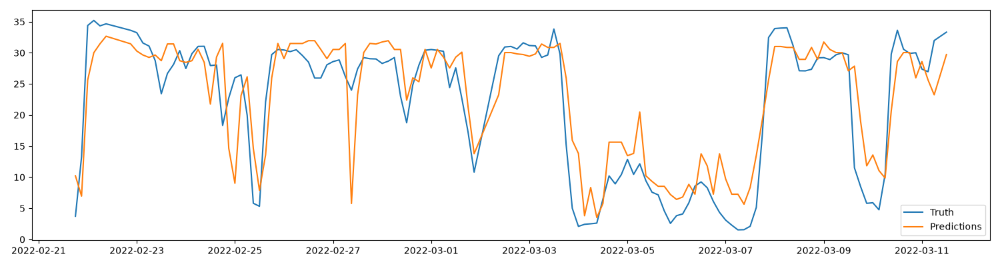
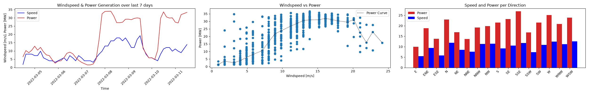

# Wind Power Forecasting with MLflow

A reproducible machine learning pipeline for forecasting wind power production in Orkney from weather inputs. The project combines temporal data alignment, wind-feature engineering, time-series model selection, and MLflow experiment tracking and model registration.

Developed as a course project and adapted from [BDM-Assignment1](https://github.com/ppcharlotte/BDM-Assignment1).

## Approach

1. Remove negative power measurements, aggregate power to three-hour means, and join weather observations by timestamp.
2. Drop rows with missing modeling inputs or targets and reserve the final 20% of observations as a chronological test set.
3. Compare four feature representations: wind speed alone; speed with sine/cosine wind direction; wind-vector components; and speed with wind-vector components.
4. Tune five regression model families using a shared five-fold `TimeSeriesSplit`, with 56 observations per validation fold.
5. Select each model family's best configuration by cross-validation RMSE, then select the overall winner using the same criterion.
6. Evaluate the winner on the held-out test period, refit it on all historical data, and forecast the weather inputs in `future.csv`.
7. Log experiments and artifacts and register the final pipeline as `OrkneyWindPowerForecaster`.

Preprocessing and estimation are combined in scikit-learn pipelines so scaling and polynomial transformations are fitted within each training fold.

### Models and Evaluation

- Linear regression
- Polynomial regression with Ridge regularization
- Random forest
- RBF support vector regression
- Gradient boosting

Evaluation uses MAE, RMSE, and R². The grid-search result table ranks candidates by MAE, while model selection uses RMSE.

## Design Decisions

- **Three-hour alignment:** Power is recorded more frequently than weather forecasts. Averaging power over three-hour windows provides a common resolution for joining the two sources. Negative power measurements and incomplete modeling rows are removed rather than imputed.
- **Circular wind features:** Compass direction wraps around at north. Sine/cosine encoding preserves this continuity; speed-weighted components also allow the models to capture interactions between wind strength and direction. Four representations are compared rather than assuming one is best.
- **Nonlinear model comparison:** Exploratory plots show a curved wind-speed–power relationship. Polynomial Ridge, tree ensembles, and RBF SVR are compared with linear regression as a simple baseline. Scaling is applied to scale-sensitive models within the pipeline.
- **Temporal validation:** The final 20% of observations are held out in time order. Five training-set validation folds each contain 56 observations, equivalent to seven days at three-hour resolution. This evaluates performance on subsequent periods while retaining an untouched final test period.
- **RMSE-based selection:** RMSE penalizes large forecast errors more strongly than MAE. Cross-validation RMSE selects the winner; MAE and R² provide complementary views. Polynomial Ridge has a slightly lower CV MAE, but SVR wins on the predefined RMSE criterion.
- **Tracking and refitting:** MLflow records configurations, metrics, and artifacts. Only the selected model is evaluated on the holdout; it is then refitted on all historical observations for future forecasting and registration.

## Reference Results

These checked-in results correspond to the supplied assignment report and local output files. They are reference results, not a verified rerun under the updated Python 3.14 dependency set, and have not been linked to the model ID from the recent serving session.

The report describes 676 modeling samples: 540 for training and 136 for testing. Reported sources are SSEN power-production data and UK Met Office weather forecasts.

| Model | Best feature representation | CV MAE (MW) | CV RMSE (MW) | CV R² |
| --- | --- | ---: | ---: | ---: |
| RBF SVR | Speed + circular direction | 4.936 | 6.479 | 0.468 |
| Polynomial Ridge | Speed + wind vector | 4.824 | 6.499 | 0.463 |
| Gradient boosting | Speed only | 5.099 | 6.669 | 0.438 |
| Random forest | Speed only | 5.020 | 6.746 | 0.425 |
| Linear regression | Speed + wind vector | 6.409 | 8.116 | 0.124 |

The selected SVR uses `C=1`, `epsilon=1.0`, and `gamma="scale"`. Its held-out performance is **MAE 3.900 MW**, **RMSE 5.207 MW**, and **R² 0.774**. Its CV RMSE is approximately **20.2% lower** than the best linear-regression configuration; this is a cross-validation comparison, not a test-set improvement claim.





Reference files are available in [`results/`](results/): the [model comparison](results/model_comparison.csv), [held-out predictions](results/test_predictions.csv), and [future forecasts](results/future_predictions.csv). The future forecasts have no observed targets in this dataset.

## Quick Start

Use Python 3.14 and run commands from the repository root.

```bash
git clone https://github.com/ppcharlotte/wind-power-forecasting-mlflow.git
cd wind-power-forecasting-mlflow

python3.14 -m venv .venv
source .venv/bin/activate
python -m pip install -r requirements.txt
python script.py
```

The full hyperparameter search can take substantial time. Paths, model grids, feature modes, and validation settings are configured in `script.py`; the search uses two parallel jobs.

Alternatively, run the packaged MLflow Project:

```bash
MLFLOW_TRACKING_URI=sqlite:///mlflow.db mlflow run . \
  --experiment-name WindPower-ProjectRuns
```

The project environment is specified in `python_env.yaml`. MLflow environment management may require additional local environment tooling.

## Data

The repository includes:

| File | Purpose |
| --- | --- |
| `data/power.csv` | Historical power production; the target is `Total` |
| `data/weather.csv` | Historical weather inputs, including `Speed` and `Direction` |
| `data/future.csv` | Weather inputs for future predictions |

All CSV files use a `time` column. Wind directions are mapped from 16 compass points to angles, then encoded as circular features or speed-weighted vector components.

## Track Experiments

Start the local MLflow UI:

```bash
mlflow ui --backend-store-uri sqlite:///mlflow.db --port 5001
```

Open [http://localhost:5001](http://localhost:5001).

Each model family has a separate experiment containing its best configuration, training and validation metrics, search grid, complete cross-validation table, and candidate model. `WindPower-FinalSelection` brings the five family winners together for comparison and records the final winner's test metrics and registered model.

The first training run creates a local `mlflow.db` and artifact directories. These generated files are excluded from version control. To use a separate tracking database:

```bash
MLFLOW_TRACKING_URI=sqlite:///fresh_mlflow.db python script.py
```

Use the same tracking URI when opening the UI or accessing the registered model.

## Outputs

| Path | Contents |
| --- | --- |
| `outputs/model_comparison.csv` | Cross-validation results for the five family winners |
| `outputs/test_predictions.csv` | Observed and predicted power for the held-out period |
| `outputs/future_predictions.csv` | Future weather inputs with `Predicted_Total` |
| `plots/eda_plots.png` | Exploratory wind and power plots |
| `plots/test_predictions.png` | Test-period predictions versus observations |
| MLflow registry | Final refitted pipeline, input signature, and example input |

The script also prints the selected model, test metrics, and first ten future predictions.

## Repository Structure

```text
├── README.md          # Project overview and usage
├── script.py          # Data preparation, training, evaluation, and registration
├── MLproject          # MLflow Project entry point
├── python_env.yaml    # MLflow-managed Python environment
├── requirements.txt   # Pinned dependencies
├── .gitignore         # Excludes local environments and experiment artifacts
├── results/           # Selected reference outputs and plots
└── data/
    ├── power.csv      # Historical power production
    ├── weather.csv    # Historical weather inputs
    └── future.csv     # Weather inputs for forecasting
```

## Scope and Limitations

This repository implements a local training and model-registration workflow. The training script does not start a prediction API; model serving is a separate step.

Missing training rows are dropped rather than imputed. A persistence baseline and additional historical-window comparisons would strengthen the evaluation. A local API call was reported to return a prediction successfully; reproducible serving instructions and its exact run linkage remain separate from the reference results above. Chronological splitting preserves temporal order, but operational use also requires checking forecast issue times and target-window alignment against the actual prediction horizon.

The full training search has not been rerun as part of preparing this public copy. Report quantitative performance from a reproducible run with its configuration and artifacts.
